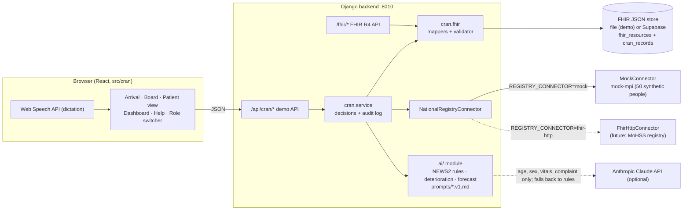

# PatientFlow

The current laptop pilot uses the **existing self-hosted Supabase stack**. Follow
[the current pilot guide](deploy/PILOT_DEPLOYMENT.md). Do not create another project,
apply migrations, restart the public app, or deploy changes without approval.
Hosted-project setup below is for other installations, not this pilot.

NECMS multi-hospital source changes are prepared behind disabled development flags.
Read [the Milestone 2B report](docs/architecture/NECMS_2B_COMPLETION_REPORT.md) before enabling them.
The new migration has only run in disposable tests; do not apply it to a hosted
project without target/schema/provenance/recovery verification and explicit execution approval.

Isolated software checks: `powershell.exe -NoProfile -ExecutionPolicy Bypass -File scripts/run-isolated-checks.ps1`.
Hospital browser checks: run `node scripts/start-necms-test.mjs`, then
`node scripts/check-hospital-browser.mjs` in another terminal. This harness uses
synthetic sessions and mocked Django responses, and blocks external HTTP traffic.

## CRAN Tech Challenge demo (synthetic data only)

AI-assisted emergency triage built on HL7 FHIR R4, with a **mock** national registry (Master Patient Index).
It runs separately from the pilot: different ports (8010 / 5180), no Supabase project, no real data.
The AI only suggests. Every level change, alert decision and signed note is confirmed by a clinician and logged with user and time.

### Run it (one command)

```powershell
npm.cmd install
python -m venv .venv; .\.venv\Scripts\python.exe -m pip install -r backend\requirements.txt   # first time only
npm.cmd run demo:cran
```

Open http://127.0.0.1:5180. The demo seeds itself on first start. **Reset demo** (top right) restores 12 waiting patients plus one scripted patient whose vitals worsen 60 seconds later. **Trigger deterioration** fires it immediately.

Tests: `npm.cmd run test:cran` (FHIR mappers and validator, registry, NEWS2 rules, deterioration, forecast, AI fallback and AI path with a mocked API, full demo script through the HTTP API, exports).

### Environment variables

Put demo settings in `.env.cran` (git-ignored). Everything is optional; with nothing set the demo runs on the rule-based engine.

| Variable | Default | Purpose |
|---|---|---|
| `ANTHROPIC_API_KEY` | empty | Enables the AI assistant (Claude). Missing or failing → rule-based engine, shown in the UI. |
| `ANTHROPIC_MODEL` | `claude-sonnet-5-5` | Model used for suggestions. |
| `AI_DISABLED` | `false` | Force the rule-based engine (rehearse the no-AI path). |
| `CRAN_STORE` | `file` | `file` (local JSON, `backend/.cran-data/`), `memory`, or `supabase` (separate synthetic-only project). |
| `CRAN_SUPABASE_URL` / `CRAN_SUPABASE_KEY` | empty | Demo Supabase project for `CRAN_STORE=supabase`. Refused if it equals the pilot project URL. |
| `VITE_CRAN_REALTIME`, `VITE_CRAN_SUPABASE_URL`, `VITE_CRAN_SUPABASE_KEY` | empty | Set `VITE_CRAN_REALTIME=supabase` for Supabase Realtime on the board (otherwise a 2-second poll). |
| `REGISTRY_CONNECTOR` | `mock` | `mock` or `fhir-http`. |
| `REGISTRY_BASE_URL` / `REGISTRY_TOKEN` | empty | Real FHIR R4 registry endpoint for `fhir-http`. |
| `CRAN_DEMO`, `VITE_CRAN_DEMO` | `false` | Set by `demo:cran`. `start.ps1` refuses to start the pilot if either is true. |

### Architecture



FHIR routes: `GET /fhir/Patient?identifier=<health-id>`, `GET /fhir/Patient/:id`, `POST /fhir/Encounter`, `POST /fhir/Observation`, `GET /fhir/Encounter/:id/$everything`, `GET /fhir/metadata`. The mock registry is also exposed as its own endpoint, `GET /mock-mpi/fhir/Patient?identifier=`.

**Why JSON FHIR documents instead of new typed tables:** the existing schema is a typed, RLS-protected multi-hospital model used by a live pilot, and the demo must not change it. Storing whole R4 resources keeps the FHIR shape exact, needs one additive table, and can live in a separate project. `supabase/cran-demo/cran_demo_schema.sql` is deliberately outside `supabase/migrations/` and is for a throwaway synthetic-data project only (it grants the anon role access).

### Swapping the mock registry for a real MoHSS registry

All registry access goes through `NationalRegistryConnector` (`backend/cran/registry.py`). It has one required method, `lookup(identifier) -> FHIR Bundle | None`, which returns the Patient first, then history. The swap is configuration:

```
REGISTRY_CONNECTOR=fhir-http
REGISTRY_BASE_URL=https://<registry>/fhir
REGISTRY_TOKEN=<token>
```

`FhirHttpConnector` calls `GET {base}/Patient?identifier=` and then `GET {base}/Patient/{id}/$everything`. A registry that is not FHIR (for example HL7 v2 or a custom API) needs a new subclass with the same `lookup` contract. Nothing else changes. The UI shows the connector's `label`. The mock says "National registry (demo mock)", and PatientFlow never claims live MoHSS connectivity.

### 3-minute demo script

| Time | Role | Do this | Show |
|---|---|---|---|
| 0:00 | — | Landing page → **Start the demo** | Tagline; AI status strip; "National registry (demo mock)" |
| 0:15 | Nurse | Arrival → type `NHI-1000001` → **Search registry** | Registry record loads; allergy (penicillin) in red; 3–4 sentence summary |
| 0:45 | Nurse | HR 118, RR 22, BP 168/98, Temp 37.2, SpO₂ 95, Alert; complaint "Central chest pain for one hour, sweating" → **Get triage suggestion** | Rule baseline (NEWS2 5 → P2 Orange) and AI suggestion with reasons, both labelled; the more urgent is highlighted |
| 1:15 | Nurse | **Confirm** | Board re-sorts; patient in the Orange group with a live timer |
| 1:30 | Nurse | Wait for the alert (60 s after reset) or press **Trigger deterioration** | Red banner "Suggest moving up to P2 Orange" with reasons → **Confirm** → board re-sorts |
| 2:00 | Doctor | Switch to **Doctor** → open the patient → **Start dictation**, speak → **Draft note** | Structured draft (complaint / findings / plan) labelled as a suggestion → edit → **Sign note**; triage history lists every decision with names and times |
| 2:35 | Supervisor | Switch to **Supervisor** → **Dashboard** | Patients and average wait by level, arrivals today, 6-hour **Forecast** with its method |
| 2:50 | Supervisor | **FHIR Bundle (today)** and **DHIS2-style report** | R4 Bundle JSON and a DHIS2-compatible dataValueSet (labelled demo) |

Before going on stage: press **Reset demo** about a minute before the deterioration step, or use **Trigger deterioration**. Rehearse once with `AI_DISABLED=true`.

### What is mocked, and known limitations

- The national registry, its identifiers (`NHI-…`), and all 50 people are synthetic. The DHIS2 export uses placeholder data element and org unit codes.
- The NEWS2 → triage-colour mapping and the deterioration threshold are demo assumptions, marked `TODO(antonio)` in `backend/ai/triage.py` and `backend/ai/deterioration.py`. They need clinical sign-off. NEWS2 is not validated for under-16s or pregnancy, and the UI warns for children.
- Demo roles have no authentication (`X-Demo-Role` header). The demo API answers only when `CRAN_DEMO=true`.
- The FHIR validator is structural (required elements, cardinality, value sets, references). It is not a full profile validator.
- Dictation uses the browser's speech recognition (Chrome/Edge), which may send audio to the browser vendor. That is acceptable for synthetic speech but must be reviewed before real use. Names and IDs are removed from the transcript before it is sent to the AI.
- The Supabase store and Realtime path are written but were not run against a live project in this build. The stage demo uses the file store.

## PatientFlow pilot

Emergency department patient tracking prototype for Starkite Technologies. Tracks every visit, assigned urgency, location, responsible clinician, pending service, and elapsed time. This is a workflow prototype; clinical priorities and colour meanings must be agreed with the hospital before clinical use.

## Run locally

Requires Node.js 22.12+ or 24 LTS and Python 3.12+ for Django.

```sh
npm install
npm run dev
```

On Windows with PowerShell script restrictions, use `npm.cmd` instead of `npm`.
Open the URL Vite prints (normally http://127.0.0.1:5173).

Without Supabase variables, the app starts in a clearly marked fictional demo. Changes are saved in this browser's local storage; other devices do not share demo data. Reset demo restores the initial fictional patients. Do not enter real patient information in demo mode.

With Supabase configured, run Django in a second terminal (commands below are for Windows):

```powershell
python -m venv .venv
.\.venv\Scripts\python.exe -m pip install -r backend\requirements.txt
.\.venv\Scripts\python.exe backend\manage.py runserver 127.0.0.1:8000
```

Set `DJANGO_DEBUG=true` in your ignored `.env` for local development. Django loads `.env.local` first and then `.env` without overriding process environment variables. For production, set `DJANGO_DEBUG=false` and a private `DJANGO_SECRET_KEY` and appropriate `DJANGO_ALLOWED_HOSTS`.

Vite proxies `/api/` requests to Django on port 8000. Supabase login and Realtime stay in the browser; patient reads and writes go through Django. Django verifies each session with Supabase Auth and forwards the user's access token to Supabase's Data API, preserving RLS, role checks, optimistic concurrency, and audit triggers. No service-role key is used.

The connection uses the authenticated HTTPS Data API to access Supabase PostgreSQL. It is not a direct PostgreSQL socket/ORM connection and does not require a database password. Application tables are owned by the existing Supabase SQL migration, so do not run `manage.py migrate` for them. Django's local runserver skips its unused ORM migration check.

## Connect Supabase

1. Create a Supabase project. Apply the SQL migrations in order in its SQL Editor:
   - `supabase/migrations/202610130001_initial.sql`
   - `supabase/migrations/202610140001_normalize_names.sql`
   - `supabase/migrations/202610140002_nurse_surgeon_roles.sql`
   - `supabase/migrations/202610140003_nurse_coordination.sql`
   - `supabase/migrations/202610140004_patient_date_of_birth.sql`
   - `supabase/migrations/202610140005_auto_patient_references.sql`

Skip migrations that have already been applied. Do not rerun migrations that have already succeeded. The second migration normalizes patient identity and staff names while preserving existing data; the third adds nurse and surgeon roles; the fourth grants nurses coordination permissions; the fifth replaces recorded age with patient date of birth.

For a fresh project, you can instead apply them from Django: add the private PostgreSQL `DATABASE_URL` from Supabase's Connect dialog to your ignored `.env` (the session pooler supports networks without direct IPv6 access), then run:

```powershell
.\.venv\Scripts\python.exe backend\manage.py apply_supabase_migrations
```

The command uses TLS, records successful migrations, checks their hashes on subsequent runs, and commits each migration together with its history entry. It rejects existing PatientFlow tables without migration history to avoid rerunning SQL previously applied in the dashboard. The database connection is only for migrations; normal application requests still use the authenticated Data API. Never prefix this private connection string with `VITE_` or commit it.
2. Create staff users in Supabase Authentication (email/password). No public sign-up is provided in this app.
3. Provision each account using the SQL Editor, replacing the placeholders:

```sql
insert into public.staff_profiles (id, first_name, last_name, role)
values ('AUTH_USER_UUID', 'Jane', 'Smith', 'coordinator');
```

Roles: `viewer` reads records; `nurse`, `surgeon`, and `clinician` read and register/update visits; `nurse` and `coordinator` additionally manage space availability. Nurses and surgeons currently share clinical permissions, including assigned urgency, identity corrections, location/space assignment, status, and handover information. Nurses coordinate patient flow, clinician assignment, care status, priorities, and space allocation. Nurses and coordinators can mark spaces available, cleaning, or unavailable; surgeons retain clinical access without these availability controls. Users cannot edit their own role. Only provision trusted staff. This first schema supports one department, not multiple hospitals or tenants.

To assign a hospital role to an existing account, use the SQL Editor:

```sql
update public.staff_profiles set role = 'nurse' where id = 'AUTH_USER_UUID';
-- Or use role = 'surgeon'. This does not create a login or a missing profile.
```

4. Enter the project URL and publishable key in your ignored `.env` or `.env.local` (legacy anon key also works), then restart Vite and Django:

```dotenv
VITE_SUPABASE_URL=https://YOUR_PROJECT.supabase.co
VITE_SUPABASE_PUBLISHABLE_KEY=YOUR_PUBLISHABLE_KEY
DJANGO_DEBUG=true
```

Never put a secret/service-role key in `VITE_*` variables. Browser access is protected by database policies and checked functions. In connected mode, patient data is not written to demo local storage.

5. Verify the read-only connection check:

```powershell
.\.venv\Scripts\python.exe backend\manage.py check_supabase
```

This checks Auth reachability and that the normalized board view blocks anonymous access. It does not apply migrations or write data. If the schema is missing, apply the SQL files in step 1. The publishable key cannot create database tables or provision staff accounts.

6. Start both servers and sign in with a provisioned staff account. Connected mode starts without demo patients. Register a fictional patient, open a second signed-in browser, and verify both boards update.

## Populate fictional patients

After applying all migrations and provisioning a clinical staff account, run:

```powershell
.\.venv\Scripts\python.exe backend\manage.py seed_demo_patients --email YOUR_STAFF_EMAIL
```

The command prompts for the password without echoing it, validates the staff login, and creates the ten fictional patients in `backend/patients/demo_data.py` through the checked Supabase function. References are generated automatically. Seed markers in handover notes let subsequent runs skip previously inserted fixtures (keep these markers if you want that behaviour). The command does not assign occupied treatment spaces or actual clinicians. It never stores passwords or tokens in files. If it stops partway through, rerun it to skip successful prior inserts. Do not run simultaneous seed commands against the same project.

## Django endpoints

| Endpoint | Method | Purpose |
| --- | --- | --- |
| `/api/health/` | GET | Process health and configuration presence; no patient data |
| `/api/board/` | GET | Staff-scoped visits, spaces, recent audit summaries, and role |
| `/api/visits/` | POST | Register a patient using `{ "input": { ... } }` |
| `/api/visits/<uuid>/` | PATCH | Update using `{ "input": { ... }, "version": 1, "patient_version": 1 }` |
| `/api/resources/<uuid>/` | PATCH | Nurse/coordinator updates using `{ "state": "cleaning" }` |

All patient endpoints require `Authorization: Bearer <Supabase user access token>`. Responses use `Cache-Control: no-store`. Django validates forms and roles before invoking the database functions; database restrictions also apply independently. An unprovisioned account is rejected. A stale edit or occupied space returns HTTP 409. Upstream failures return a generic error without exposing database details or credentials.

## Behaviour

- Patient identity lives in `patients` (`patient_ref`, `first_name`, `last_name`, `date_of_birth`). Visits reference `patient_id` and store the care episode. The RLS-aware `visit_board` view joins identity and episode data for the frontend; it does not store a second copy of names. Age is calculated from DOB at the visit arrival date using the Africa/Johannesburg calendar; it is not stored in the active schema. Unknown DOB remains NULL. The old recorded ages are preserved in the administrator-only `patient_age_migration_archive`, without inventing birth dates.
- New patient registrations generate references in PostgreSQL, such as `PF-000001`. The sequence supports concurrent registration and preserves existing references. Reference numbers may have gaps after rolled-back requests. Select an existing patient in the registration form to reuse their identity for a repeat visit rather than generate another reference; active duplicate visits remain blocked. Demo references use `DEMO-PF-` and are only local to the browser.
- Staff profiles store `first_name` and `last_name`. Full names are composed for display. Names support multi-word components, punctuation, and Unicode.
- Existing names are split provisionally and flagged `names_need_review`; review them before saving. Original patient names are retained in the administrator-only `patient_name_migration_archive`, and original staff names in the restricted `legacy_name` column. Historical audit snapshots remain unchanged.
- The migration chooses the most recently updated identity for repeat references (case insensitive); review conflicting original names in the archive. Patient name and DOB corrections apply to all visits for that patient and generate an audit event. Both visit and patient versions prevent stale edits. Existing patient references cannot be changed from the visit editor.

- Priorities P1–P5 and their colours are illustrative, manually assigned, and not an implemented clinical triage algorithm.
- Queue position counts waiting/ready patients within the same next service, ordered by urgency then arrival time. It is not a guaranteed treatment time or automated clinical scheduling decision.
- Resources can be available, cleaning, or unavailable. Occupancy is derived from active visits. Database row locks and a unique index prevent double assignment; optimistic version checks prevent silently overwriting a concurrent edit.
- Discharge/transfer releases the assigned space and keeps the visit in Completed visits. Staff should update cleaning status as appropriate.
- Writes append an audit event. Database audit snapshots are not selectable by frontend staff; the UI exposes summaries. No patient deletion is exposed.
- Realtime updates trigger a fresh fetch. A 30-second refresh also recovers missed events; connection state, last sync, and fetch errors are visible.
- Display mode hides patient names and complaints and removes editing controls. It is still an authenticated staff display with patient references, not a public waiting-room view or a security boundary.

## Validation

```sh
npm test
npm run test:database
npm run build
```

```powershell
.\.venv\Scripts\python.exe backend\manage.py test patients
```

Django tests cover session validation, token forwarding, access roles, server-side validation, version requirements, workflow conflicts, and safe upstream failures. They mock Supabase HTTP responses and never write to the live project.

Automated tests cover service ordering, exclusion rules, reprioritisation, and input validation. Database checks use embedded PostgreSQL (PGlite) with mocked Auth identities to test the actual schema, policies, and functions; the Supabase-specific Realtime publication is excluded from that local check. See `supabase/tests/workflow.sql` for transactional checks on a development Supabase database.

With the dev server running and Microsoft Edge installed, `npm run test:browser` verifies the demo workflows and saves desktop/mobile screenshots in ignored `test-results/`. It uses an isolated browser context and never changes your normal browser's demo records. Managed Supabase Auth, Realtime, and cross-device synchronisation still need verification on your project; no live database credentials are included.

If your normal environment is connected to Supabase, use `node scripts/start-demo.mjs` for an isolated fictional demo on port 5174. Point the browser check at it using `PREVIEW_URL=http://127.0.0.1:5174`.

## Scope and deployment

React + TypeScript + Vite + Tailwind CSS, Django REST Framework, and Supabase Auth/Postgres/Realtime. Production hosting must serve the built `dist` frontend and reverse proxy `/api/` to a production Django WSGI server under the same origin. Vite's development proxy is not included in the static build. Configure the public Supabase variables at frontend build time and the server variables in Django's environment. Work is local in the supplied GitHub checkout; nothing is published automatically.

Before clinical deployment, validate local triage policy, role permissions, patient identity matching, security and retention requirements, backups and restore, outage procedures, load/concurrency, and integration with existing clinical records. The prototype has no EHR integration, automatic vitals monitoring, clinical alerts, offline editing, MFA enforcement, or production availability guarantees. Supabase Free can pause inactive projects and should be treated as a development environment here.
