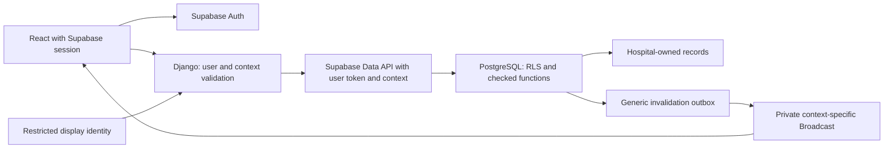

# NECMS multi-hospital design — proposed, not implemented

This design extends the inspected PatientFlow stack. It establishes facility isolation before introducing clinical triage protocols. Existing P1–P5 values remain explicitly legacy prototype data during Milestone 2; no new medical criteria or automatic prioritization are proposed.

See the [baseline](NECMS_BASELINE.md), [migration plan](NECMS_MIGRATION_PLAN.md) and [acceptance tests](NECMS_SECURITY_TEST_PLAN.md).

## Architecture and authority

React retains Supabase authentication and calls Django. Django forwards the verified user's bearer token to PostgreSQL through the Supabase Data API. PostgreSQL validates membership, selected context, capabilities and ownership on every operation, including requests that bypass Django. Ordinary clinical requests never use a service-role key. Migration/admin credentials are isolated from the application and browser.

A frontend hospital ID is a requested destination, not authorization. Access requires a live membership and a validated database-backed context. Global `staff_profiles.role` must cease granting clinical access after cutover. The application does not decide treatment or acuity; qualified staff retain that authority.

## Proposed entities and relationships

Names are design targets; no tables are created in Milestone 1.

| Entity | Required fields and relationship |
| --- | --- |
| `hospitals` | UUID, stable unique facility code, name, public/private/other configured type, active state, timezone, version and timestamps. Facility classifications require confirmation. |
| `departments` | UUID, hospital FK, code/name, active state; unique hospital/code and hospital/UUID. A department is an organizational scope, not a patient's bed. |
| `hospital_memberships` | UUID, hospital FK, staff Auth UUID, active/suspended/revoked state, authorization version, validity window, granting/revoking actor and reason. Unique hospital/user. Reactivations retain history and increment authorization version. |
| `hospital_roles`, `capabilities`, `role_capabilities` | Hospital-owned role definitions mapped to a centrally reviewed capability vocabulary. Names alone grant nothing. |
| `membership_roles`, `membership_departments` | Many-to-many role grants and explicit departmental scope for a membership. Granting authority and history are recorded. A facility-wide scope must be explicit, never inferred from no department rows. |
| `hospital_configuration_versions` | Immutable hospital-owned configuration revisions, approved actor/time; current revision pointer on hospital. Display allowlist, language/timezone and operational settings. No invented triage algorithms. |
| `access_contexts` | Random opaque UUID, user, membership, hospital, authorization version, department scope, clinical/display purpose, creation/expiry/revocation. Bound to current membership, never transferable between users. Private storage. |
| Existing `patients` | Add hospital ownership and ownership state. Keep UUID, reference, first/last names, DOB, review metadata and version. Each patient identity is local to one hospital in this phase. |
| Existing `visits` | Logical emergency encounters; retain physical table/name and UUID initially. Add hospital and department ownership. Patient, optional resource and department must belong to the same hospital. |
| Existing `resources` | Add hospital/department ownership; retain UUID, name, kind/state. Names become unique within hospital, not nationally. |
| Existing `audit_events` | Add hospital attribution/ownership state without rewriting original snapshots. New actions record membership/context/request metadata separately. Original actor and timestamps remain intact. |
| Private provenance/quarantine records | Record entity type/UUID, disposition, evidence reference, reviewer and time without moving/deleting source rows. No access for ordinary clinical users. |
| Private `operational_outbox` | Generic refresh notifications with hospital/context routing metadata; no patient details or encounter identifiers in transmitted payloads. Delivery has retries and bounded retention. |
| Private `request_deduplication` | Hospital, actor, operation, request UUID, payload digest and saved result UUID for idempotent scoped writes. Retention policy documented; mismatched retry payloads rejected. |

Staff identity remains global; facility employment/access is represented by memberships. A nurse in one hospital may have different capabilities in another. No national patient matching, name/DOB merge, or automatic cross-hospital record sharing is introduced. A future transfer creates authorized separate facility records with explicit governance; it does not grant the receiving hospital blanket access to the originating record.

Departments and treatment spaces are distinct from care workflow and acuity. Milestone 2 adds ownership, not a new clinical lifecycle. Later assessment, observation, task, service request, escalation, handover and movement entities reference the encounter with the same hospital constraints.

## Capabilities and least privilege

Initial capability vocabulary: `patient.identity.read`, `patient.identity.update`, `encounter.read`, `encounter.register`, `encounter.update_legacy`, `resource.read`, `resource.coordinate`, `audit.summary.read`, `display.read`, `hospital.configure`, `membership.manage`. These are operational permissions; none implies authority to perform a future clinical assessment.

Preserve current nurse coordination and surgeon visit editing only through explicitly approved hospital role grants. A viewer needs an approved minimal view; do not automatically grant notes/identity access from its old name. Configuration and membership administration do not implicitly grant clinical access. Administrators can assign only capabilities within their delegated authority, with no self-elevation. New memberships start without clinical grants until reviewed. No automatic conversion of a global staff role into all-hospital access.

An encounter-reading capability does not automatically expose all patient identity or audit snapshot columns. Use checked board projections or invoker views whose returned columns match capabilities; restrict base-table SELECT grants to genuinely required fields. An invoker view does not magically mask columns or bypass base RLS. Audit snapshots stay unavailable to ordinary summary readers. Department scope is checked as well as hospital scope on departmental records; broad patient identity access needs its own hospital-approved rule.

## Validated selected context

Proposed contract:

1. `GET /api/hospitals/` lists only the authenticated user's active authorized memberships with minimal facility metadata.
2. `POST /api/hospital-contexts/` requests a hospital, purpose and department scope. A checked database function derives the user from `auth.uid()`, verifies membership validity/capabilities and issues a short-lived opaque context. No caller-supplied user ID or role is accepted.
3. Clinical requests send `X-NECMS-Context: <opaque-context-id>` and use `/api/hospitals/<hospital-id>/...`. Django validates the context and requires the route hospital to match it. It forwards the context header and original user token upstream.
4. PostgreSQL reads the request context from PostgREST `request.headers`, resolves the private context row, and checks user binding, membership state/validity, authorization version, expiry, purpose and current grants. Caller headers are untrusted until resolved. Empty, forged, expired or mismatched context denies access.
5. The context grants only its selected hospital and scope, even for staff with two memberships. Another hospital requires an explicit new context. Contexts are per session/tab; a mutable global selected-hospital setting must not switch other users/tabs silently.
6. A context ID in a write RPC must match the validated request header. Do not support a second weaker context path. Legacy routes/RPCs must either require this same context or deny access; no fallback to global role.

PostgREST documents request headers as transaction-local settings; header propagation and casing must be verified against the actual hosted version before release. [PostgREST transactions](https://docs.postgrest.org/en/v12/references/transactions.html).

The context is not a substitute for fresh membership checks. Revocation/suspension, grant removal and expiry invalidate subsequent reads/writes with existing JWTs. Do not use JWT hospital/role claims as the sole authority or cache positive authorization across requests. Already delivered data cannot be recalled; clear browser data on revocation/context switch and define kiosk session behavior. Write authorization locks the membership row `FOR SHARE`; revocation updates it under an exclusive row lock, so revocation completion occurs after previously authorized writes finish and subsequent writes are denied. Specify/test lock ordering to avoid deadlocks. Reads begun before a revocation commit may already have returned data; no system can retroactively retract it.

## PostgreSQL isolation and function security

- Enable RLS on every clinical/ownership/configuration/membership/context table before exposure. Default denial; `anon` has no patient/encounter/display access. Table ownership and BYPASSRLS roles remain privileged deployment concerns.
- Clinical SELECT policies require a validated clinical context, matching hospital, verified ownership, appropriate capability and applicable department scope. Hospital filtering in queries is an optimization, not authorization.
- Keep ordinary direct INSERT/UPDATE/DELETE revoked. If direct writes are introduced later, both `USING` and `WITH CHECK` must enforce hospital/capability constraints; changing ownership must never be an ordinary edit.
- Apply the same rules to `visit_board`, audit summaries, resources, patient lookup and all alternate views/functions. Inventory and close every obsolete function overload. PostgreSQL permissive policies combine with OR; leaving an old global-role policy would defeat isolation.
- Add composite FKs for hospital/patient, hospital/resource and hospital/department relationships. A patient or resource UUID alone is insufficient. Optional resource FKs allow no resource; assigned resources must match ownership. Quarantine rows cannot participate in ordinary verified encounters.
- Security-definer functions use a fixed empty search path, fully qualified objects, narrow execute grants and explicit `auth.uid()` checks. Validate context/membership/capability before lookup and again within the locked mutation transaction. Derive hospital from context; never trust `p_input.hospital_id` as authority.
- Use narrowly owned helper functions for RLS to avoid recursive policies on private membership/context tables. Their only exposed result is the authorization decision or validated current context, not unrestricted membership data. No dynamic SQL, caller-controlled search path or general arbitrary-query function.
- Reference generation remains private. Any retained old reference/default helper cannot grant clinical access. Keep UUIDs and references; scope lookup and uniqueness to hospital as appropriate.
- Write functions lock encounter/patient/resource rows, require versions, preserve atomic audit changes and check the active-space constraint. Idempotency keys prevent duplicate registration on retry within the authorized hospital. A reused key with a changed payload is a conflict.
- Cross-hospital object requests produce generic denial/not-found errors; do not reveal whether a foreign record exists. Log authorization decisions with request metadata, not tokens or patient payloads.

RLS and privileged credentials are separate concerns: service keys and owner connections can bypass policies and must not be supplied to normal request paths. [Supabase RLS](https://supabase.com/docs/guides/database/postgres/row-level-security).

## Django and React integration

Add context validation near authentication/permissions, not as repeated ad hoc route filters. `gateway.py` forwards the context and token on every clinical call; `views.py` uses hospital-bound query projections and scoped RPCs. Serializers reject inconsistent body/route ownership. Django data responses carry `Cache-Control: no-store`; logs/errors omit clinical payloads. Authentication remains with Supabase.

React adds a minimal authorized facility selector and context state around the existing board. On switch, invalidate outstanding requests, clear patients/resources/audit/dialog state, unsubscribe old channels, and then load the new context. Bind each response to its context/generation; ignore late responses from the previous hospital. Never render old hospital records beneath the newly selected label. Active encounters load independently of paginated historical records so row limits cannot hide active care. No UI rewrite is needed.

## Realtime isolation

The current common raw Postgres Changes subscriptions cannot depend on an HTTP context header being available in the websocket authorization path. Milestone 2 replaces browser clinical-row subscriptions with **private Broadcast invalidations** followed by fresh contextual Django reads. Hospital query filters and channel names alone are not security.

Each context has its own opaque topic. Join RLS on `realtime.messages` checks the authenticated user, live context/membership, purpose and allowed scope. Clients have read-only channel access and cannot publish authoritative changes. Disable public channel access in hosted configuration. A trusted outbox publisher checks current eligible contexts and emits only a constant refresh-required event; no patient data, IDs, counts, timestamps of clinical events or resource details are in the payload. Hospital/context routing remains server-side. Invalidation delivery failure falls back to authorized polling and visible stale-state feedback.

Supabase documents that Broadcast authorization is cached during a connection: membership revocation alone does not immediately eject a connected listener. Therefore use live eligibility checks at delivery, stop sending to revoked context topics, and disconnect/renew channels on expiry/revocation. A stale socket must never contain patient data; the next read is denied. Do not claim join RLS alone proves instantaneous revocation. Recheck expiry/revocation after queued notifications and test real hosted behavior. If this transport cannot pass acceptance tests, ship scoped polling first, with raw clinical subscriptions disabled, rather than weakening isolation. [Supabase Realtime authorization](https://supabase.com/docs/guides/realtime/authorization).

## Privacy-safe shared displays

Current React wall mode is a presentation option, not the security boundary. Introduce a dedicated display identity/context with `display.read`, an approved hospital/department and no clinical/identity/base-table read capability. No personal staff session should remain signed in on an unattended wall screen.

`GET /api/hospitals/<id>/display-board/` invokes a narrowly checked PostgreSQL projection function. Because display identities cannot read base clinical tables, this function must explicitly validate display context and return only named, approved fields; never `SELECT *` or arbitrary filters. Suggested default: encounter-local opaque display label, controlled workflow label, controlled space label and approved aggregate operational indicators. Clinical category/color is deferred until an approved protocol/display policy exists. Exclude names, DOB, global references, patient UUIDs, complaints, notes, staff free text and audit summaries. Controlled labels/configuration must also be reviewed for identifying content.

The restricted dataset is enforced before delivery, including direct RPC calls and websocket traffic. Inspect network responses/storage, not only hidden DOM text. Display tokens cannot fetch `/board`, patients, encounters or clinical audit data directly. No shared cache of clinical responses; short-lived sessions, device revocation and audience/placement policies need hospital approval.

## Decisions required before Milestone 2 release

Verified facility provenance; hospital/department identifiers and boundaries; capability matrix and delegated administrators; facility-wide versus department-limited patient identity access; membership onboarding/revocation procedures; context lifetimes; display audience/allowlist; Supabase private-channel settings; hosting/backup/data-residency governance and downtime procedures. Public/private facility type does not itself authorize data sharing. National identity linkage, clinical protocol approval, observations, reassessment and emergency unidentified arrival workflow remain later milestones requiring qualified hospital input.
